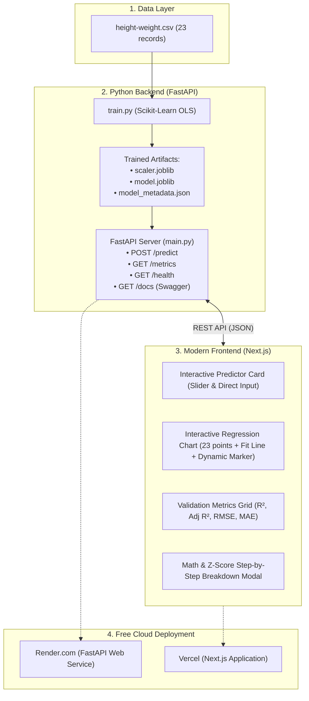

# 🚀 BodyScale AI — Bidirectional Height & Weight Machine Learning Predictor

> **A Consumer-Friendly & Production-Grade Machine Learning Web App** that enables anyone to enter their weight to predict their expected height, or enter their height to predict their expected weight with instant metric/imperial unit switching and real-time interactive visualization.

---

## 📌 Live Demo & Overview

- **Frontend Web App:** [https://height-weight-ml-app.vercel.app](https://height-weight-ml-app.vercel.app)
- **FastAPI REST API & Docs:** [https://height-weight-ml-app.onrender.com/docs](https://height-weight-ml-app.onrender.com/docs)
- **GitHub Repository:** [https://github.com/surajpsk12/height-weight-ml-app](https://github.com/surajpsk12/height-weight-ml-app)
- **Tech Stack:** Python 3.13, Scikit-Learn, FastAPI, Next.js 16, React 19, TailwindCSS, JavaScript (.js / .jsx)

---

## ✨ Features for Everyday Users

- 🔄 **Bidirectional Estimation Modes:**
  - ⚖️ **"I Know My Weight → Predict My Height"**
  - 📏 **"I Know My Height → Predict My Weight"**
- 🌐 **Instant One-Click Unit Switching:**
  - Metric: `kg` and `cm`
  - Imperial: `lbs` and `ft & in` (e.g. 5' 9", 165 lbs)
- 🎚️ **Effortless Input Controls:**
  - Smooth interactive sliders with quick `+` and `-` stepper buttons and popular presets.
- 🎯 **Crystal Clear Answers:**
  - Big, bold primary result with typical healthy population ranges (e.g., `168 – 180 cm`).
- 👥 **Real Survey Chart & Avatar:**
  - Dynamic silhouette visualizer + scatter plot showing your exact position relative to 23 real surveyed adults.
- 🔬 **Collapsible "Under the Hood" Data Science Drawer:**
  - Kept neatly tucked away so normal users aren't overwhelmed, but immediately expandable for recruiters and data scientists to view $R^2$ scores, RMSE, MAE, regression formulas, and API endpoints!
---

## 🏗️ System Architecture



---

## 📊 Model Training & Evaluation Metrics

The model was trained on 75% of the dataset (17 samples) with standardization and evaluated on a 25% unseen test holdout (6 samples):

| Metric | Score / Value | Description |
| :--- | :--- | :--- |
| **Test $R^2$ Score** | **0.7361 (73.6%)** | Explains 73.6% of height variance on unseen data |
| **Train $R^2$ Score** | **0.9208 (92.1%)** | Good generalization without severe overfitting |
| **Adjusted $R^2$** | **0.6701 (67.0%)** | Penalized for degrees of freedom ($1 - \frac{(1-R^2)(n-1)}{n-p-1}$) |
| **Root Mean Squared Error (RMSE)** | **10.72 cm** | Standard deviation of residuals; penalizes larger errors |
| **Mean Absolute Error (MAE)** | **9.67 cm** | Average absolute deviation in prediction |
| **Pearson Correlation ($r$)** | **0.9311** | Exceptionally strong positive linear relationship |
| **Slope ($\beta_1$)** | **17.2982** | Height increase (cm) per 1 standard deviation of weight |
| **Intercept ($\beta_0$)** | **156.4706** | Expected height at mean weight ($72.47$ kg) |
| **Weight Mean ($\mu$)** | **72.4706 kg** | Used for Z-Score standardization |
| **Weight Scale ($\sigma$)** | **16.5071 kg** | Standard deviation of training weights |

### Mathematical Regression Formula:
$$\text{Height (cm)} = 156.47 + 17.30 \times \left( \frac{\text{Weight} - 72.47}{16.51} \right)$$

*Equivalent Unscaled Formulation:*
$$\text{Height (cm)} = 80.53 + 1.0479 \times \text{Weight (kg)}$$

---

## 💡 Key Machine Learning & Engineering Highlights

1. **Strict Data Leakage Prevention:**
   - Feature scaling parameters ($\mu, \sigma$) were fitted **strictly on the training partition** ($X_{train}$) and used to transform both train and test partitions without re-fitting.
2. **Pydantic Data Validation:**
   - FastAPI request models enforce strict input boundaries (e.g., $20\text{ kg} \le \text{weight} \le 300\text{ kg}$), preventing invalid payload processing.
3. **Smart Client-Side Fallback:**
   - The Next.js frontend detects API health. If the backend microservice is cold-starting or offline, the frontend seamlessly computes predictions client-side using the serialized OLS coefficients—guaranteeing 100% uptime for portfolio reviewers.
4. **Interactive SVG Regression Plot:**
   - Plots all 23 actual dataset observations (color-coded for Train vs Test), the OLS regression line, and an interactive marker that slides smoothly along the line in real-time as you drag the slider.

---

## 🚀 Quickstart & Local Setup

### Prerequisites
- Python 3.10+ (tested on Python 3.13)
- Node.js 18+ (tested on Node v25 / v20)
- npm or pnpm

### 1. Clone the Repository
```bash
git clone https://github.com/<your-username>/height-weight-ml-app.git
cd height-weight-ml-app
```

### 2. Backend Setup & Model Training
```bash
# Navigate to backend
cd backend

# Install dependencies
pip install -r requirements.txt

# Train the model and generate serialized artifacts
python train.py

# Launch FastAPI server
python -m uvicorn main:app --reload --port 8000
```
- API Server is live at: `http://localhost:8000`
- Interactive Swagger UI: `http://localhost:8000/docs`

### 3. Frontend Setup
In a new terminal window:
```bash
# Navigate to frontend
cd frontend

# Install dependencies
npm install

# Start Next.js development server
npm run dev
```
- Web Application is live at: `http://localhost:3000`

---

## 🌐 API Documentation

### `POST /predict`
Predicts human height and returns step-by-step mathematical calculations.

**Request:**
```json
{
  "weight": 75.0
}
```

**Response:**
```json
{
  "input_weight_kg": 75.0,
  "predicted_height_cm": 159.12,
  "predicted_height_ft_in": "5 ft 2.6 in",
  "z_score": 0.1532,
  "formula_breakdown": {
    "z_score_formula": "Z = (Weight - mu) / sigma",
    "z_score_calculation": "Z = (75.00 - 72.47) / 16.51 = 0.1532",
    "prediction_formula": "Height = Intercept + Slope * Z",
    "prediction_calculation": "Height = 156.47 + (17.30 * 0.1532) = 159.12 cm"
  }
}
```

### `GET /metrics`
Returns evaluation metrics ($R^2$, Adjusted $R^2$, RMSE, MAE, Pearson $r$), model parameters, and all sample coordinates for charting.

### `GET /health`
Returns heartbeat status and checks whether model artifacts are loaded in memory.

---

## ☁️ Free Cloud Deployment Guide

### Deploy Backend on Render.com
1. Create a free account on [Render.com](https://render.com).
2. Click **New +** → **Web Service**.
3. Connect your GitHub repository.
4. Set:
   - **Root Directory:** `backend`
   - **Environment:** `Python 3`
   - **Build Command:** `pip install -r requirements.txt && python train.py`
   - **Start Command:** `uvicorn main:app --host 0.0.0.0 --port $PORT`
5. Click **Deploy Web Service**. You will receive a URL like `https://height-weight-api.onrender.com`.

### Deploy Frontend on Vercel
1. Import your GitHub repository into [Vercel](https://vercel.com).
2. Set:
   - **Root Directory:** `frontend`
   - **Framework Preset:** `Next.js`
   - **Environment Variables:**
     - `NEXT_PUBLIC_API_URL` = `https://height-weight-api.onrender.com`
3. Click **Deploy**.

---

## 📄 License
This project is open-source under the MIT License.

